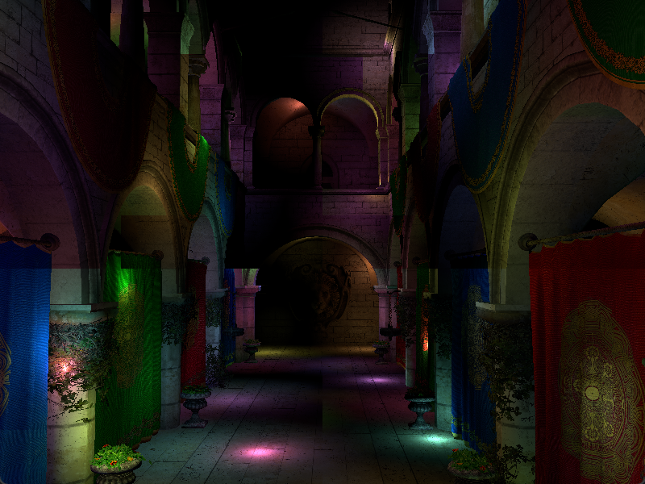

WebGL Forward+ and Clustered Deferred Shading
======================

**University of Pennsylvania, CIS 565: GPU Programming and Architecture, Project 4**

- Zachary Leong
  - [LinkedIn](https://linkedin.com/in/zleong), [personal website](https://zacharyleong.com)
- Tested on: Windows 11, Ultra 9 185H @ 2.30GHz 32GB, RTX 4060 Laptop (personal)

### Live Demo

Link: https://zdragonite21.github.io/Project4-WebGPU-Forward-Plus-and-Clustered-Deferred/

### bloopers

### thoughts

Doing this homework in rust + wgpu was a much larger task than I had anticipated. I, unfortunately, did not get to doing the deferred part of this homework.

### performance analysis

Forward plus has an average frame time (cpu side recorded) of 20ms for 5k lights, while the naive has average frame time of 150ms for 5k lights. 

### sources

- https://sotrh.github.io/learn-wgpu/

### Credits

- [Vite](https://vitejs.dev/)
- [loaders.gl](https://loaders.gl/)
- [dat.GUI](https://github.com/dataarts/dat.gui)
- [stats.js](https://github.com/mrdoob/stats.js)
- [wgpu-matrix](https://github.com/greggman/wgpu-matrix)
